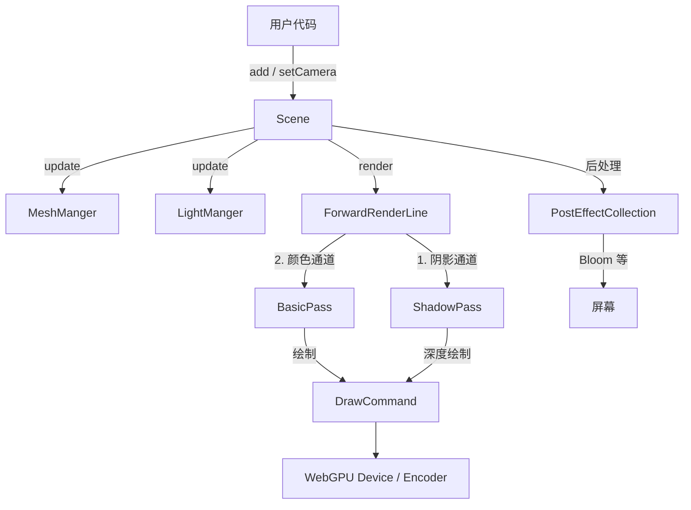
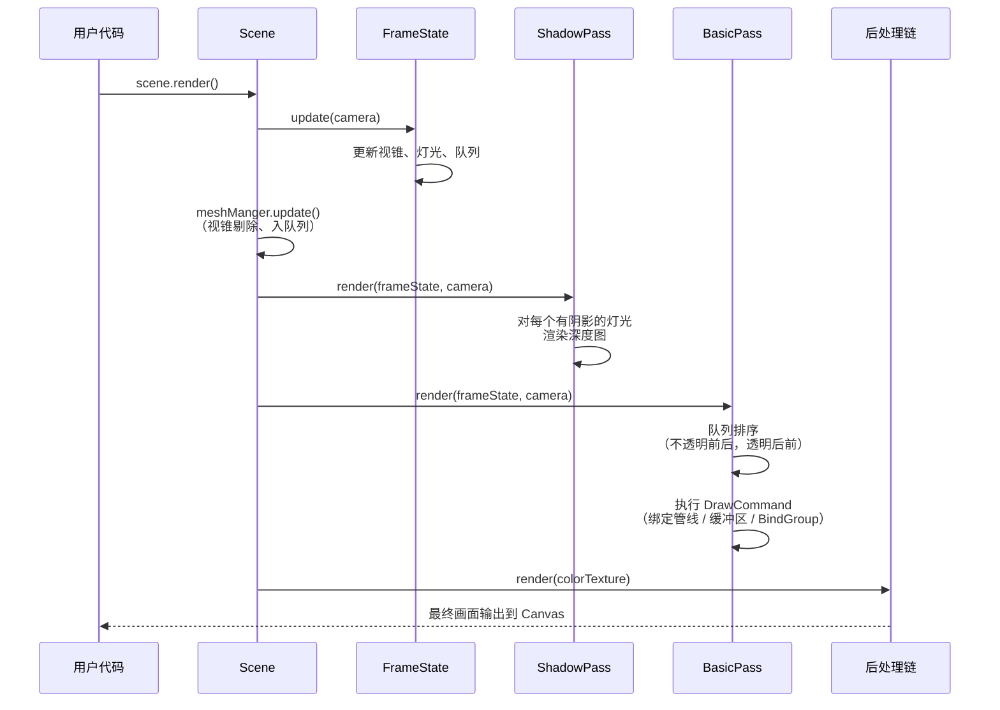
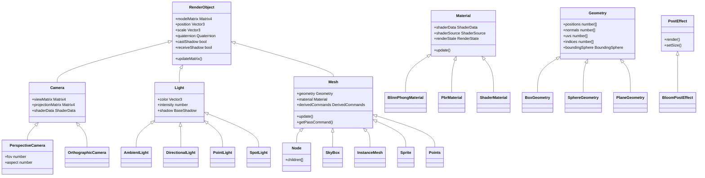
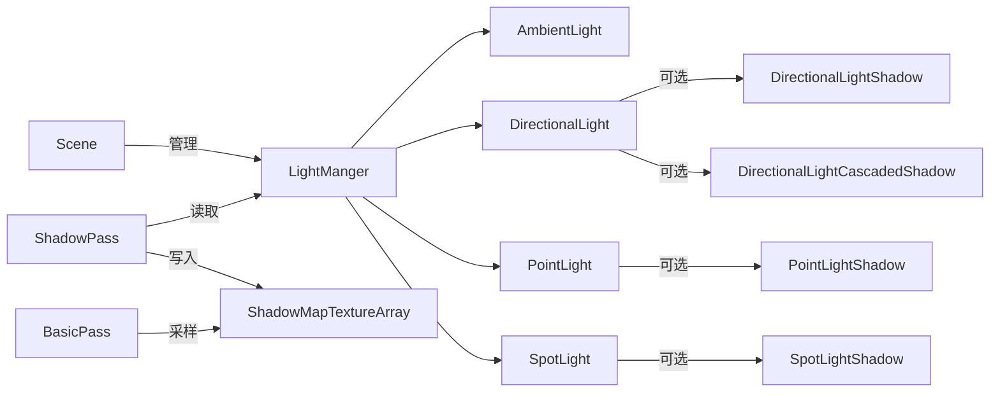

# GEngine — 系统架构

## 目录

1. [整体架构](#整体架构)
2. [目录结构](#目录结构)
3. [渲染管线](#渲染管线)
4. [数据流：从场景创建到画面输出](#数据流从场景创建到画面输出)
5. [类继承关系](#类继承关系)
6. [核心子系统详解](#核心子系统详解)
   - [Scene 与 FrameState](#scene-与-framestate)
   - [Material 系统](#material-系统)
   - [Geometry 系统](#geometry-系统)
   - [Mesh 系统](#mesh-系统)
   - [Light 与 Shadow 系统](#light-与-shadow-系统)
   - [Shader 系统](#shader-系统)
   - [后处理系统](#后处理系统)
   - [渲染基础设施](#渲染基础设施)

---

## 整体架构



---

## 目录结构

```
src/
├── index.ts                  ← 公共 API 出口（70+ 导出）
├── Scene.ts                  ← 场景入口，驱动渲染循环
├── wgsl.d.ts                 ← .wgsl 文件 TypeScript 声明
│
├── camera/                   ← 相机系统
│   ├── Camera.ts             ← 抽象基类
│   ├── PerspectiveCamera.ts  ← 透视相机
│   ├── OrthographicCamera.ts ← 正交相机
│   └── PointLightShadowCamera.ts ← 点光阴影专用
│
├── compute/                  ← WebGPU Compute 支持
│   └── Compute.ts
│
├── control/
│   └── OrbitControl.ts       ← 轨道相机控制器
│
├── core/                     ← 引擎核心基础设施
│   ├── FrameState.ts         ← 每帧状态（渲染队列、灯光、视锥）
│   ├── RenderQueue.ts        ← 不透明 / 透明 / 天空盒队列
│   ├── DerivedCommands.ts    ← DrawCommand 缓存工厂
│   ├── LightManger.ts        ← 灯光管理与阴影贴图数组
│   ├── MeshManger.ts         ← 场景 Mesh 管理
│   ├── RenderObject.ts       ← 所有场景实体的变换基类
│   ├── ShaderDataFactory.ts  ← ShaderData 创建工具
│   ├── TextureCache.ts       ← GPU 纹理缓存管理
│   ├── BoundingBox.ts        ← AABB 包围盒
│   ├── BoundingSphere.ts     ← 球形包围体
│   ├── Frustum.ts            ← 视锥体裁剪
│   ├── CullingVolume.ts
│   └── WebGPUConstant.ts     ← WebGPU 枚举常量
│
├── geometry/                 ← 几何体
│   ├── Geometry.ts           ← 抽象基类
│   ├── BoxGeometry.ts
│   ├── PlaneGeometry.ts
│   ├── SphereGeometry.ts
│   ├── TorusKnotGeometry.ts
│   ├── PointGeometry.ts
│   └── SkyBoxGeometry.ts
│
├── light/                    ← 光源
│   ├── Light.ts              ← 基类
│   ├── AmbientLight.ts
│   ├── DirectionalLight.ts
│   ├── PointLight.ts
│   ├── SpotLight.ts
│   └── shadows/              ← 各光源的阴影实现
│
├── loader/                   ← 资源加载
│   ├── GLTFLoader.ts
│   ├── CubeTextureLoader.ts
│   └── gltf/                 ← GLTF 解析子模块
│
├── material/                 ← 材质系统
│   ├── Material.ts           ← 基类
│   ├── BlinnPhongMaterial.ts
│   ├── PbrMaterial.ts
│   └── ShaderMaterial.ts
│
├── math/                     ← 数学库
│   ├── Vector2/3/4.ts
│   ├── Matrix3/4.ts
│   ├── Quaternion.ts
│   ├── Euler.ts
│   ├── Color.ts
│   └── Spherical.ts
│
├── mesh/                     ← 可渲染对象
│   ├── Mesh.ts               ← 核心网格
│   ├── Node.ts               ← 层级容器
│   ├── Instance.ts
│   ├── InstanceMesh.ts       ← 实例渲染
│   ├── SkyBox.ts
│   ├── Sprite.ts
│   ├── Points.ts
│   └── Axes.ts
│
├── pass/                     ← 渲染通道
│   ├── BasicPass.ts          ← 颜色渲染通道
│   ├── ShadowPass.ts         ← 阴影深度通道
│   └── RenderPass.ts
│
├── post-process/             ← 后处理
│   ├── PostEffect.ts         ← 基类
│   ├── BloomPostEffect.ts
│   └── PostEffectCollection.ts
│
├── render/                   ← WebGPU 原语封装
│   ├── Context.ts            ← GPUDevice / Canvas 初始化
│   ├── Buffer.ts             ← GPU Buffer
│   ├── Texture.ts            ← GPU Texture
│   ├── Sampler.ts
│   ├── BindGroup.ts
│   ├── DrawCommand.ts        ← 单次绘制调用
│   ├── RenderState.ts        ← 管线状态
│   ├── RenderTarget.ts       ← 离屏渲染目标
│   ├── Pipeline.ts           ← Pipeline 缓存
│   └── ShaderData.ts         ← BindGroup 管理
│
├── renderpipeline/           ← 渲染管线策略
│   └── ForwardRenderLine.ts  ← 前向渲染实现
│
├── shader/                   ← 着色器系统
│   ├── ShaderSource.ts       ← 着色器编译与缓存
│   ├── Shaders.ts            ← 预置着色器注册表
│   ├── WGSLParseDefines.ts   ← #ifdef 预处理器
│   └── shaderChunk/          ← 可复用 WGSL 代码片段
│
├── type/                     ← TypeScript 类型声明
└── utils/                    ← 工具函数（loadTexture 等）
```

---

## 渲染管线



### 渲染通道说明

| 通道 | 输入 | 输出 | 说明 |
|------|------|------|------|
| **ShadowPass** | 场景 Mesh、各灯光位置 | 阴影贴图数组（Texture2DArray） | 每个有阴影的灯光各一张深度图 |
| **BasicPass** | 场景 Mesh、相机、光照数据 | 颜色纹理 + 深度纹理 | 排序后顺序绘制所有可见物体 |
| **PostEffect** | BasicPass 颜色纹理 | 处理后颜色纹理 | 可链式叠加多种后处理效果 |

---

## 数据流：从场景创建到画面输出

```
第一帧初始化:
  Scene({ container })
    → 获取 canvas / WebGPU Adapter / Device
    → 创建 ForwardRenderLine (BasicPass + ShadowPass)
    → 初始化 Context / FrameState / MeshManger / LightManger

场景搭建:
  scene.add(mesh)   → MeshManger.add(mesh)
  scene.add(light)  → LightManger.add(light)
  scene.setCamera() → 绑定相机 ShaderData

每帧 scene.render():

  ① 更新阶段
      FrameState.update(camera)
        ├── LightManger.update() — 收集灯光 Uniform
        └── Frustum.update()    — 更新裁剪平面

      MeshManger.update(frameState, camera)
        └── 对每个 Mesh:
            ├── updateMatrix()  — 递归更新模型矩阵
            ├── geometry.update() — 视锥剔除 + 相机距离
            ├── material.update() — 更新 Uniform 缓冲区
            └── 按透明度加入 opaque / transparent 队列

  ② 阴影阶段 (ShadowPass)
      对每个带阴影的灯光:
        └── 以灯光视角渲染所有不透明 Mesh 到深度图

  ③ 颜色阶段 (BasicPass)
      RenderQueue.sort()
      ├── 不透明队列 (近 → 远，Z-prepass 优化)
      └── 透明队列  (远 → 近，正确混合)

      对每个 Mesh 执行 DrawCommand:
        ├── ShaderData.bind()       — 材质 BindGroup
        ├── LightShaderData.bind()  — 全局光照 BindGroup
        ├── Camera.ShaderData.bind()— 相机矩阵 BindGroup
        ├── RenderState.bind()      — 管线状态
        ├── VertexBuffer.bind()
        ├── IndexBuffer.bind()
        ├── Pipeline.bind()         — 从缓存获取 GPURenderPipeline
        └── drawIndexed() / draw()

  ④ 后处理阶段
      PostEffectCollection → 按顺序执行效果链 → 输出到屏幕
```

---

## 类继承关系



---

## 核心子系统详解

### Scene 与 FrameState

**Scene** ([src/Scene.ts](../src/Scene.ts)) 是引擎入口，负责：
- 创建并持有 WebGPU `Context`
- 管理 `MeshManger`（场景物体）和 `LightManger`（光源）
- 驱动 `ForwardRenderLine` 执行渲染
- 协调 `PostEffectCollection` 后处理链

**FrameState** ([src/core/FrameState.ts](../src/core/FrameState.ts)) 是帧内共享状态：
```typescript
class FrameState {
  renderQueue: RenderQueue;  // opaque / transparent / pre / debug
  lightManger: LightManger;
  frustum: Frustum;          // 视锥剔除平面
  background: Color | Texture;
  drawCallnums: number;      // 当帧统计
  frameNumber: number;
}
```

---

### Material 系统

| 材质 | 文件 | 特点 |
|------|------|------|
| `BlinnPhongMaterial` | [src/material/BlinnPhongMaterial.ts](../src/material/BlinnPhongMaterial.ts) | 经典 Blinn-Phong 光照，支持法线贴图 |
| `PbrMaterial` | [src/material/PbrMaterial.ts](../src/material/PbrMaterial.ts) | 基于物理渲染，支持 IBL（图像照明） |
| `ShaderMaterial` | [src/material/ShaderMaterial.ts](../src/material/ShaderMaterial.ts) | 完全自定义 WGSL 着色器 |

**Material 核心属性** ([src/material/Material.ts](../src/material/Material.ts))：

```typescript
class Material {
  shaderData: ShaderData;       // GPU Uniform / Texture 绑定
  shaderSource: ShaderSource;   // 编译好的着色器模块
  renderState: RenderState;     // 混合、深度、面剔除等管线状态
  color: Color;
  baseTexture: Texture;
  transparent: boolean;
  opacity: number;
  light: boolean;               // 是否参与光照计算
}
```

---

### Geometry 系统

所有几何体继承 `Geometry` ([src/geometry/Geometry.ts](../src/geometry/Geometry.ts))，通过 `setAttribute()` 提交顶点数据：

```typescript
// 典型内部构造
setAttribute(new Float32Attribute("position", positions, 3));
setAttribute(new Float32Attribute("normal", normals, 3));
setAttribute(new Float32Attribute("uv", uvs, 2));
setIndice(indices);
calculateTangents();  // 自动计算切线（法线贴图所需）
```

预置几何体：

| 类 | 构造参数 |
|----|---------|
| `BoxGeometry` | `(width, height, depth)` |
| `PlaneGeometry` | `(width, height)` |
| `SphereGeometry` | `(radius, widthSegments, heightSegments)` |
| `TorusKnotGeometry` | `(radius, tube, tubularSegments, radialSegments, p, q)` |
| `PointGeometry` | `(positions[])` |
| `SkyBoxGeometry` | 内部构造，无参数 |

---

### Mesh 系统

**Mesh** ([src/mesh/Mesh.ts](../src/mesh/Mesh.ts)) 是引擎的基本可渲染单元：

```typescript
class Mesh extends RenderObject {
  geometry: Geometry;
  material: Material;
  frustumCull: boolean;       // 默认 true
  derivedCommands: DerivedCommands;  // 渲染命令缓存

  update(frameState, camera) {
    // 1. 更新变换矩阵
    // 2. 视锥剔除
    // 3. 更新材质 Uniform
    // 4. 推入渲染队列
  }
}
```

| 特殊 Mesh | 文件 | 用途 |
|-----------|------|------|
| `Node` | [src/mesh/Node.ts](../src/mesh/Node.ts) | 层级容器，有 `children` |
| `InstanceMesh` | [src/mesh/InstanceMesh.ts](../src/mesh/InstanceMesh.ts) | GPU 实例渲染，适合大量重复物体 |
| `SkyBox` | [src/mesh/SkyBox.ts](../src/mesh/SkyBox.ts) | 总在队列最前面渲染 |
| `Sprite` | [src/mesh/Sprite.ts](../src/mesh/Sprite.ts) | 始终朝向相机的 2D 四边形 |
| `Points` | [src/mesh/Points.ts](../src/mesh/Points.ts) | 点云渲染器 |

---

### Light 与 Shadow 系统



**LightManger** 维护各灯光类型的 `Texture2DArray` 阴影贴图，传递给所有材质 Shader。

---

### Shader 系统

**ShaderSource** ([src/shader/ShaderSource.ts](../src/shader/ShaderSource.ts)) 负责：
1. 维护 `defines`（如 `{ HAS_NORMAL: true, USE_IBL: 1 }`）
2. 在 `defines` 变化时重新编译 WGSL 模块
3. 缓存编译结果（`dirty` 标志位）

**WGSL 预处理器** ([src/shader/WGSLParseDefines.ts](../src/shader/WGSLParseDefines.ts)) 支持 C 风格条件编译：

```wgsl
#ifdef HAS_NORMAL
  let normal = normalize(normalMatrix * inNormal);
#endif

#if USE_IBL == 1
  let env = sampleEnvironment(normal);
#endif
```

**预置着色器注册** ([src/shader/Shaders.ts](../src/shader/Shaders.ts))：

| 键名 | 用途 |
|------|------|
| `phong` | BlinnPhong 材质顶点 / 片元 |
| `pbr` | PBR 材质顶点 / 片元 |
| `skybox` | 天空盒 |
| `shadowMap` | 深度阴影渲染 |
| `point` | 点云渲染 |
| `sprite` | 精灵渲染 |

**Shader Chunk** 可复用代码片段通过 `#include` 引入：
- `shaderChunk/commonFrag.wgsl`
- `shaderChunk/lightCalc.wgsl`
- `shaderChunk/normal.wgsl`

---

### 后处理系统

```
BasicPass 输出
    ↓
BloomPostEffect
  1. 提取高亮区域（高通滤波）
  2. 多级 Mip 高斯模糊（可分离）
  3. 合并所有模糊级别
  4. 与原图混合
    ↓
PostEffectCollection → Canvas
```

后处理效果接口：
```typescript
class PostEffect {
  render(context, inputTexture: Texture): Texture;
  setSize(width: number, height: number): void;
}
```

---

### 渲染基础设施

| 类 | 文件 | 职责 |
|----|------|------|
| `Context` | [src/render/Context.ts](../src/render/Context.ts) | WebGPU Device / Adapter / Canvas 初始化 |
| `Buffer` | [src/render/Buffer.ts](../src/render/Buffer.ts) | Vertex / Index / Uniform / Storage Buffer |
| `Texture` | [src/render/Texture.ts](../src/render/Texture.ts) | GPU 纹理，支持动态更新、Mipmap |
| `Sampler` | [src/render/Sampler.ts](../src/render/Sampler.ts) | 过滤模式、寻址模式封装 |
| `BindGroup` | [src/render/BindGroup.ts](../src/render/BindGroup.ts) | GPUBindGroup 封装，含动态偏移支持 |
| `DrawCommand` | [src/render/DrawCommand.ts](../src/render/DrawCommand.ts) | 单次绘制调用状态完整封装 |
| `RenderState` | [src/render/RenderState.ts](../src/render/RenderState.ts) | 混合/深度/模板/剔除/图元拓扑 |
| `RenderTarget` | [src/render/RenderTarget.ts](../src/render/RenderTarget.ts) | 离屏渲染目标（颜色 + 深度附件） |
| `Pipeline` | [src/render/Pipeline.ts](../src/render/Pipeline.ts) | `GPURenderPipeline` 缓存（避免重复创建） |
| `ShaderData` | [src/render/ShaderData.ts](../src/render/ShaderData.ts) | BindGroup 抽象，按 binding 绑定资源 |

**DrawCommand** 执行过程：
```typescript
command.render({ device, passEncoder, camera }) {
  shaderData.bind(device, passEncoder);           // 材质 group=0
  camera.shaderData.bind(device, passEncoder);    // 相机 group=1
  lightShaderData.bind(device, passEncoder);      // 光照 group=2
  renderState.bind();                             // viewport/depth/blend
  vertexBuffers.forEach(vb => vb.bind());
  indexBuffer.bind();
  pipeline.bind(passEncoder);                     // 从缓存获取 Pipeline
  passEncoder.drawIndexed(count, instanceCount);
}
```
